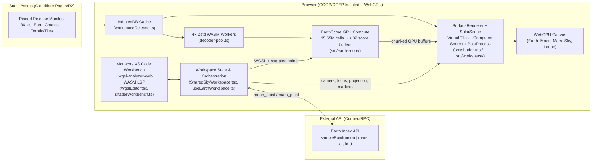

# Earth Connect — Development Introduction

Welcome to **Earth Connect**. This guide explains how the codebase is structured, how the data and GPU pipelines fit together, how to run and verify changes locally, and where to plug in new product features (UI panels, presets, AI assistant/chat workflows, or new planetary comparisons) without having to touch the 3D engine internals.

---

## 1. What Earth Connect Does & The Core Mental Model

Earth Connect helps users explore planetary analogues: pick a site on the **Moon** or **Mars** (or define custom geophysical criteria), write or generate a scoring function in **WGSL** (`fn score(cell: EarthCell) -> f32`), and evaluate it across **~31.88 million 4 km Earth land cells** in roughly **14 ms** on the user's GPU, painted live onto an interactive 3D Earth/Moon/Mars sky.

### The Crucial Architectural Shift ("Where is the database?")

If you are coming from a traditional web app (React frontend → REST/GraphQL API → SQL/DuckDB database → server cache), Earth Connect works differently:

- **There is no database or backend query engine for Earth scoring.**
- All frozen 4 km Earth measurements live as **36 Zstandard-compressed chunks** (alongside terrain and texture assets, ~395 MB total across 60 files) hosted on a static Cloudflare CDN (`https://earth-connect-assets.pages.dev`, pinned in [`cdn/pinned-release.json`](../cdn/pinned-release.json)).
- On first load, the browser downloads the pinned release, verifies every file's SHA-256 hash, and persists it locally in **IndexedDB** (`earth-connect-release-data`). Subsequent loads read directly from IndexedDB with zero network transfer.
- Four Web Workers decompress the chunks using a Rust-compiled `zstd.wasm` module and upload the unpacked dataset (~534 MB) straight into **WebGPU storage buffers** in GPU memory.
- Every query compiles the user's WGSL `score(cell)` function into a **WebGPU compute shader** and executes it locally on the user's GPU. Because queries run locally in ~14 ms, **no server-side L2 query cache is needed for Earth scoring**.

### What the External Backend (`Earth Index API`) Is Used For

The external service ([`src/earthIndexApi.ts`](../src/earthIndexApi.ts), defaulting to `https://earth-index-crisrpia.fly.dev`, overridable via `VITE_EARTH_INDEX_API_URL`) uses ConnectRPC / gRPC-Web and is only called for **live Moon and Mars point sampling**:

- When a user clicks a spot on the Moon or Mars — or writes `moon_point(lat, lon)` / `mars_point(lat, lon)` in a WGSL shader — the client calls `samplePoint(body, latitude, longitude)` to retrieve terrain, temperature, composition, illumination, and radar measurements for that exact coordinate.
- Results are cached in memory by [`src/workspace/planetaryPointCache.ts`](../src/workspace/planetaryPointCache.ts).
- Everything else — Earth scoring, contrast calibration, 3D rendering, terrain virtual tiles, and WGSL language analysis — runs **100% locally in the browser**.

---

## 2. High-Level Architecture



The codebase is organized into **four clean subsystems**:

| Subsystem               | Location                                                                                                            | Responsibility                                                                                                                                                                                                             |
| ----------------------- | ------------------------------------------------------------------------------------------------------------------- | -------------------------------------------------------------------------------------------------------------------------------------------------------------------------------------------------------------------------- |
| **Workspace UI & IDE**  | [`src/workspace/`](../src/workspace/)                                                                               | Startup/download screen, React workspace layout, embedded Monaco/VS Code tabs, WGSL language server, Moon/Mars point picking & caching, and solar-system scene orchestration.                                              |
| **Earth Score Compute** | [`src/earth-score/`](../src/earth-score/)                                                                           | Standalone WebGPU compute library: Zstd worker decoding, GPU buffer packing, WGSL shader compilation/lowering, and full-world scoring dispatch.                                                                            |
| **WebGPU 3D Renderer**  | [`src/shader-test/`](../src/shader-test/) + [`src/workspace/shaders/`](../src/workspace/shaders/)                   | Custom WebGPU renderer: Earth globe/Equal Earth flat map, 500 m virtual tile streaming, Moon/Mars terrain, score texture packing & GPU histogram, motion blur, Rayleigh atmospheres, bloom, and Shift-hover optical loupe. |
| **Tooling & Pipelines** | [`scripts/`](../scripts/), [`cdn/`](../cdn/), [`tools/`](../tools/), [`vendor/`](../vendor/), [`tests/`](../tests/) | Offline dataset/tile build scripts, CDN release pinning, Rust WASM Zstd decoder, generated ConnectRPC protobuf stubs, and automated unit/GPU tests.                                                                        |

---

## 3. Getting Started & Daily Workflow

### Prerequisites

- **Node.js 24+** and **npm**
- A **WebGPU-capable browser** (Chrome / Chromium / Edge on desktop, or Firefox with WebGPU enabled)
- **[`prek`](https://github.com/j178/prek)** (recommended) for running pre-commit hooks locally
- **Python 3 + `ruff`** (only needed if you edit offline asset scripts in `scripts/`)

### First-Time Setup

```bash
npm install
prek install   # installs .git/hooks/pre-commit (Biome + Ruff + syntax checks)
npm run dev    # starts Vite at http://localhost:5173/
```

On the first visit to `http://localhost:5173/`, the startup screen downloads the pinned asset bundle into IndexedDB. To force a fresh download from the CDN later, open `http://localhost:5173/?refreshCache=1`.

### Common Commands

| Command                    | What it does                                                                                                                     |
| -------------------------- | -------------------------------------------------------------------------------------------------------------------------------- |
| `npm run dev`              | Starts Vite dev server with required `COOP`/`COEP` headers.                                                                      |
| `npm run format`           | Formats TS/TSX/JS/MJS/CSS/JSON/HTML/MD with Biome (`biome.json`).                                                                |
| `npm run format:check`     | Checks formatting without modifying files.                                                                                       |
| `npm run lint`             | Runs ESLint across the repo.                                                                                                     |
| `npx tsc -b --noEmit`      | Full TypeScript project-reference typecheck.                                                                                     |
| `npm run test:shader`      | Fetches render assets if needed and runs all 63 Node `--test` unit tests.                                                        |
| `npm run test:compute`     | Fetches compute data and runs `tests/earth-score/compute.test.ts`.                                                               |
| `npm run test:compute:gpu` | Builds `earth-score` bundle and runs WebGPU compute tests via Playwright.                                                        |
| `npm run build`            | Production build into `dist/` (includes `public/`).                                                                              |
| `npm run build:pages`      | Cloudflare Pages build into `dist-pages/` (copies `public/_headers`, omits large local `public/` assets so the CDN serves them). |
| `npm run fetch:assets`     | Downloads pinned CDN assets into `public/` for local offline dev/tests.                                                          |

### Why `COOP` / `COEP` Headers Matter

[`vite.config.ts`](../vite.config.ts) (and [`public/_headers`](../public/_headers) in production) sends:

```http
Cross-Origin-Opener-Policy: same-origin
Cross-Origin-Embedder-Policy: credentialless
```

This enables `SharedArrayBuffer`, which the embedded `wgsl-analyzer-web` WASM language server needs. Any new external URLs or APIs you fetch from the browser must support CORS without requiring cookies under `COEP: credentialless`.

---

## 4. Guided Codebase Tour (Recommended Reading Order)

If you want to scan the entire repo from top to bottom, read it in this order:

### A. App Boot, Asset Caching & Startup

1. [`index.html`](../index.html) → [`src/workspace/pagesBootstrap.ts`](../src/workspace/pagesBootstrap.ts) → [`src/workspace/pagesApp.tsx`](../src/workspace/pagesApp.tsx) — HTML shell, pre-React bootstrap, and workspace mount.
2. [`src/workspace/WorkspaceStartup.tsx`](../src/workspace/WorkspaceStartup.tsx) — Startup progress UI; downloads/verifies CDN assets via [`workspaceRelease.ts`](../src/workspace/workspaceRelease.ts), resolves URLs via [`workspaceAssets.ts`](../src/workspace/workspaceAssets.ts), and prewarms the WebGPU device/world via [`workspacePrewarm.ts`](../src/workspace/workspacePrewarm.ts).
3. [`src/workspace/earthWorkspaceResources.ts`](../src/workspace/earthWorkspaceResources.ts) — Shared lifecycle owner for the `GPUDevice`, `EarthScore` instance, and `planetaryPointCache`.

### B. Workspace UI & Embedded Monaco Workbench

4. [`src/workspace/SharedSkyWorkspace.tsx`](../src/workspace/SharedSkyWorkspace.tsx) — Top-level UI shell: body switcher (Earth / Moon / Mars), globe vs. flat-map projection toggle, Moon/Mars point picker & copy/insert popover, shader status/error display, and layout hosting both the 3D canvas and the editor.
5. [`src/workspace/useEarthWorkspace.ts`](../src/workspace/useEarthWorkspace.ts) — **The bridge hook** connecting React UI state to `SurfaceRenderer`, `SolarScene`, `EarthScore`, and `planetaryShaderAnalysis`. Start here to understand every command the UI can send to the engine.
6. [`src/workspace/shaderProject.ts`](../src/workspace/shaderProject.ts) — Multi-file WGSL project model persisted to IndexedDB (`score.wgsl`, helper files, and built-in examples like `hello-world.wgsl` and `comparisonExamples.ts`), plus line-offset mapping (`assembleShaderProject`, `findShaderLocation`).
7. [`src/workspace/WgslEditor.tsx`](../src/workspace/WgslEditor.tsx) & [`src/workspace/shaderWorkbench.ts`](../src/workspace/shaderWorkbench.ts) — Embedded `@codingame/monaco-vscode-api` workbench (multi-group split tabs, custom preview panes in [`shaderPreviewEditor.ts`](../src/workspace/shaderPreviewEditor.ts), Vim mode toggle, project actions in [`registerShaderProjectActions.ts`](../src/workspace/registerShaderProjectActions.ts), and live diagnostics/completions from [`wgslLanguageServer.ts`](../src/workspace/wgslLanguageServer.ts)).

### C. Planetary Sampling & WGSL Prelude

8. [`src/earthIndexApi.ts`](../src/earthIndexApi.ts) — ConnectRPC client (`samplePoint`, `loadDatasource`) backed by generated stubs in [`vendor/earth-index/`](../vendor/earth-index/).
9. [`src/workspace/planetaryPointCache.ts`](../src/workspace/planetaryPointCache.ts) — Coordinate canonicalization and in-memory cache for Moon/Mars samples.
10. [`src/workspace/planetaryShaderAnalysis.ts`](../src/workspace/planetaryShaderAnalysis.ts) — Static analyzer that parses `moon_point(lat, lon)` / `mars_point(lat, lon)` calls out of user WGSL so they can be fetched before GPU compilation.
11. [`src/earth-score/planetShaderSchema.ts`](../src/earth-score/planetShaderSchema.ts) & [`src/earth-score/custom-shader.ts`](../src/earth-score/custom-shader.ts) — Defines the `EarthCell`, `MoonPoint`, and `MarsPoint` WGSL structs, generates the editor prelude (`SCORE_SHADER_PRELUDE`), and lowers `moon_point(...)`/`mars_point(...)` calls into constant structs injected into the compute shader.

### D. Earth Score GPU Compute Engine (`src/earth-score/`)

12. [`src/earth-score/index.ts`](../src/earth-score/index.ts) — Main `EarthScore` class (`load`, `dispatchShader`, `query`, `dispose`). See [`src/earth-score/README.md`](../src/earth-score/README.md) for compute-specific API docs.
13. [`src/earth-score/manifest.ts`](../src/earth-score/manifest.ts) & [`src/earth-score/layout.ts`](../src/earth-score/layout.ts) — 460 MODIS sinusoidal tiles, 36 chunks, 35,554,320 stored addresses, and coordinate decoding tables.
14. [`src/earth-score/decoder-pool.ts`](../src/earth-score/decoder-pool.ts), [`src/earth-score/decoder-worker.ts`](../src/earth-score/decoder-worker.ts), [`src/earth-score/decode.ts`](../src/earth-score/decode.ts) — 4-worker parallel Zstd WASM decompression and GPU upload.
15. [`src/earth-score/scoring.ts`](../src/earth-score/scoring.ts) & [`src/earth-score/query.ts`](../src/earth-score/query.ts) — Bit-packed column unpacking WGSL (`sourceCodeWGSL`), quantized `u32` score encoding (`0..65534`, `65535 = SCORE_MISSING`), and CPU/GPU query helpers.

### E. WebGPU 3D Renderer (`src/shader-test/` & `src/workspace/`)

16. [`src/shader-test/renderer.ts`](../src/shader-test/renderer.ts) — `SurfaceRenderer`: owns the frame loop, pointer/wheel/arcball/flight controls, Earth/Moon/Mars picking, progressive HiDPI DPR-1 → 4-tile DPR-2 settle scheduling, and Shift-hover optical loupe.
17. [`src/workspace/solarScene.ts`](../src/workspace/solarScene.ts), [`solarSystem.ts`](../src/workspace/solarSystem.ts), [`solarCamera.ts`](../src/workspace/solarCamera.ts), [`flightEasing.ts`](../src/workspace/flightEasing.ts) — Real astronomical ephemeris (`astronomy-engine`), Moon/Mars placement in the shared sky, smooth focus flights, and starfield ([`skyMap.ts`](../src/workspace/skyMap.ts)).
18. [`src/shader-test/surface-shader.ts`](../src/shader-test/surface-shader.ts) & [`src/shader-test/shaders/surface.wgsl`](../src/shader-test/shaders/surface.wgsl) — Earth globe and Equal Earth flat-map shading: WGS84 ellipsoid, GEBCO elevation/bathymetry, pre-baked normals/ridge AO ([`terrain-normals.ts`](../src/shader-test/terrain-normals.ts)), 500 m virtual tiles ([`earth-tiles.ts`](../src/shader-test/earth-tiles.ts), [`virtual-tiles.ts`](../src/shader-test/virtual-tiles.ts)), analytical elevation contours ([`contours.ts`](../src/shader-test/contours.ts)), Cox-Munk ocean glint, and score heatmap blending.
19. [`src/workspace/planetTerrain.ts`](../src/workspace/planetTerrain.ts), [`planetTerrainMesh.ts`](../src/workspace/planetTerrainMesh.ts), [`planetTiles.ts`](../src/workspace/planetTiles.ts) — Moon & Mars subdivided sphere geometry, DEM displacement, and virtual tile streaming.
20. [`src/shader-test/computed-scores.ts`](../src/shader-test/computed-scores.ts), [`computed-score-layout.ts`](../src/shader-test/computed-score-layout.ts), [`score-style.ts`](../src/shader-test/score-style.ts) — Packs `EarthScore` compute buffers into `r16uint` 2D-array texture banks, builds peak-preserving max mip pyramids (so small hotspots remain visible when zoomed out), and runs a GPU histogram to auto-calibrate the Magma contrast curve.
21. [`src/shader-test/postprocess.ts`](../src/shader-test/postprocess.ts) & [`motion-blur.ts`](../src/shader-test/motion-blur.ts) — 4× MSAA `rgba16float` HDR resolve, depth-aware camera motion blur, post-motion Earth/Mars Rayleigh atmospheres, separable half-res bloom, ACES tone mapping, crisp world markers, screen-bounded hover reticle, and optical loupe pass.

---

## 5. How a User Shader Runs (End-to-End Lifecycle)

When a user edits WGSL in the workbench and runs it (or auto-runs on edit):

1. **Module Assembly (`shaderProject.ts`):** `selectShaderModule` + `assembleShaderProject` concatenate the active shader tab (and any helper tabs when editing `score.wgsl`) while recording line ranges so compiler diagnostics map back to the exact tab and line number.
2. **Live Editor Intelligence (`wgslLanguageServer.ts`):** While typing, `WgslEditor.tsx` appends the virtual `SCORE_SHADER_PRELUDE` (which declares `EarthCell`, `MoonPoint`, `MarsPoint`, `NO_DATA`, `NO_SCORE`, `has_data`, `moon_point`, `mars_point`) and streams the virtual document to `wgsl-analyzer-web` for instant autocomplete, hover docs, and type checking.
3. **Planetary Point Extraction (`planetaryShaderAnalysis.ts` → `useEarthWorkspace.ts`):** Before GPU compilation, the analyzer locates every constant `moon_point(lat, lon)` and `mars_point(lat, lon)` call. `resolveShaderPoints` deduplicates coordinates and fetches up to 4 in parallel through `planetaryPointCache` → `earthIndexApi.samplePoint`.
4. **Compute Compilation & Dispatch (`EarthScore.dispatchShader`):** `custom-shader.ts` lowers each planetary call into a constant WGSL struct literal, wraps the user's `fn score(cell: EarthCell) -> f32` inside the compute entry point, compiles the pipeline (surfacing any WebGPU `compilationInfo` diagnostics back to Monaco), and dispatches across all 36 chunks. Each cell writes a `u32` score in `0..65534` (or `65535` for `NO_SCORE` / missing).
5. **Texture Packing, Max Mips & Contrast Calibration (`SurfaceRenderer.setComputedScores`):**
   - [`computed-scores.ts`](../src/shader-test/computed-scores.ts) copies the 36 chunk score buffers into `r16uint` 2D-array texture banks indexed by MODIS tile `(h, v)`.
   - A compute pass builds **peak-preserving max mipmaps** so narrow high-scoring valleys or ridges never vanish when viewing the whole planet.
   - A sharded GPU histogram counts the score distribution; [`score-style.ts`](../src/shader-test/score-style.ts) derives auto-contrast bounds for the Magma colormap so both narrow and broad score distributions read clearly.
6. **Live Inspection:** Hovering or clicking Earth reads back the exact cell coordinates, elevation, and computed score for `useEarthWorkspace`'s `inspection` state.

### GPU Data Flow & LLM Analysis Hook Points (Sequence Diagram)

Because Earth's 35.55M cell dataset lives in GPU storage buffers rather than a backend database, an AI assistant / analysis layer retrieves results by hooking into specific CPU↔GPU boundaries:

```mermaid
sequenceDiagram
  autonumber
  actor User as User / Chat Tile
  participant WS as useEarthWorkspace.ts<br/>(React Orchestrator)
  participant API as Earth Index API<br/>(planetaryPointCache.ts)
  participant ES as EarthScore (GPU)<br/>(src/earth-score/)
  participant CS as prepareComputedScores (GPU)<br/>(computed-scores.ts)
  participant SR as SurfaceRenderer (GPU)<br/>(renderer.ts)

  rect rgb(30, 41, 59)
    Note over WS,ES: Startup (once per GPUDevice)
    WS->>ES: loadEarthScore(device, manifestUrl)
    Note right of ES: 4× Zstd WASM workers decode 36 chunks<br/>and upload packedInput (~534 MB) + lookup<br/>directly into GPU STORAGE buffers
  end

  rect rgb(23, 37, 84)
    Note over User,SR: Scoring Run (~14 ms warm GPU)
    User->>WS: Edit / run WGSL shader (or LLM tool call)
    WS->>API: Resolve moon_point() / mars_point() calls
    API-->>WS: Typed MoonPoint / MarsPoint samples [Hook C]
    WS->>ES: dispatchShader(wgsl, points)
    Note right of ES: Compute shader unpacks packedInput + lookup,<br/>runs score(cell) across 36 chunks →<br/>writes u32 scores[chunk] (0..65534 | 65535)
    ES-->>WS: Compute submitted
    WS->>SR: setComputedScores(earthScore)
    SR->>CS: prepareComputedScores(device, earthScore)
    Note right of CS: 1. Pack 36 chunks → r16uint 2D-array banks<br/>2. Build peak-preserving max mip pyramid<br/>3. Sharded GPU histogram (65,535 bins)<br/>4. Track per-half-tile peak (920 peaks across 460 tiles)
    CS-->>SR: MAP_READ copy → CPU: { histogram, peaks, bestAddress } [Hook A]
    SR->>SR: ScoreDistribution auto-contrast + render frame
  end

  rect rgb(20, 50, 40)
    Note over User,SR: On-Demand Readbacks (Inspection & LLM Analysis)
    User->>SR: Hover / click Earth cell
    SR->>CS: readComputedScore(site, x, y) (4-byte MAP_READ) [Hook B]
    CS-->>WS: inspection { lat, lon, score, elevation }
    User->>ES: (Future LLM tool) readCells(topKAddresses) [Hook D]
    Note right of ES: Tiny compute pass unpacks 25 EarthCell fields<br/>from packedInput + lookup for N addresses →<br/>small MAP_READ staging buffer (~1–4 KB)
    ES-->>User: Full EarthCell structs for LLM reasoning
  end
```



### Where to Hook for LLM / Analytical Data Retrieval

You do **not** need to duplicate the 534 MB Earth dataset in JavaScript memory or stand up a query database to let an LLM inspect results. Use these four hooks:

| Hook                                                      | What it gives the LLM                                                                                                                                                                                                     | Where it lives                                                                                                                                                 | Cost / Status                                                                                                                                                                                         |
| --------------------------------------------------------- | ------------------------------------------------------------------------------------------------------------------------------------------------------------------------------------------------------------------------- | -------------------------------------------------------------------------------------------------------------------------------------------------------------- | ----------------------------------------------------------------------------------------------------------------------------------------------------------------------------------------------------- |
| **Hook A — Global distribution & top-K hotspots**         | Full 65,535-bin `histogram` (`ScoreDistribution`: valid cell count, quantiles, `atLeast(threshold)`, global `best`) **plus** 920 per-half-tile `peaks` (highest-scoring cell per half MODIS tile across the whole globe). | [`computed-scores.ts`](../src/shader-test/computed-scores.ts) (`prepareComputedScores`, lines 367–385) + [`score-style.ts`](../src/shader-test/score-style.ts) | **Already copied to CPU RAM on every shader run.** Currently only `bestAddress` is returned; returning the sorted top-K peaks (mapped to `lat/lon` via `EarthScore.layout`) adds zero extra GPU work. |
| **Hook B — Single-cell score & pointer inspection**       | Exact score, elevation, and `(lat, lon)` at any specific MODIS cell or under the user's cursor.                                                                                                                           | [`computed-scores.ts`](../src/shader-test/computed-scores.ts) (`readComputedScore`) & `useEarthWorkspace().inspection`                                         | **Exists today** (4-byte GPU→CPU readback).                                                                                                                                                           |
| **Hook C — Moon & Mars measurements**                     | Full typed `MoonPoint` / `MarsPoint` measurements (terrain, thermal, illumination, FeO/Ti/Th composition, radar, TES minerals).                                                                                           | [`planetaryPointCache.ts`](../src/workspace/planetaryPointCache.ts) (`readPoint`) & [`earthIndexApi.ts`](../src/earthIndexApi.ts)                              | **Exists today** (ConnectRPC + client cache).                                                                                                                                                         |
| **Hook D — Raw 25-field `EarthCell` readout for N sites** | All 25 underlying Earth measurements (`slope_mean_deg`, `surface_low_c`, `annual_precip_mm`, etc.) at the top-K hotspots or a clicked point so the LLM can explain _why_ a region scored high or low.                     | New tiny helper on [`EarthScore`](../src/earth-score/index.ts) (e.g. `readCells(addresses)`)                                                                   | **Recommended next addition (~1 ms).** Dispatch a small compute shader over `packedInput` + `lookup` for just the requested `N` addresses and read back a ~1–4 KB staging buffer.                     |

### Quick Reference: What a Scoring Shader Sees

Every user shader implements `fn score(cell: EarthCell) -> f32` and returns a finite score (higher = brighter) or `NO_SCORE` to hide the overlay at that cell:

- **Terrain:** `elevation_median_m`, `slope_mean_deg`, `relief_5km_m`, `relief_21km_m`, `tpi_5km_m`, `tpi_21km_m`
- **Climate & Ground Temp:** `annual_precip_mm`, `coldest_month_air_c`, `warmest_month_air_c`, `surface_day_c`, `surface_night_c`, `surface_mean_c`, `surface_low_c`, `surface_high_c`, `surface_range_c`
- **Land Cover & Geology:** `bare_fraction`, `permanent_snow_ice_fraction`, `permafrost_fraction`, `dominant_lithology_code`
- **Quality Fractions:** `terrain_valid_fraction`, `landcover_valid_fraction`, `permafrost_valid_fraction`, `surface_day_valid_fraction`, `surface_night_valid_fraction`, `surface_paired_valid_fraction`
- **Coordinates:** `latitude_deg`, `longitude_deg`, `grid_x`, `grid_y`
- **Built-ins:** `NO_DATA`, `NO_SCORE`, `has_data(x)`, `moon_point(lat, lon)`, `mars_point(lat, lon)`

---

## 6. How the WebGPU Renderer & Shaders Are Structured

All GPU shaders live as standalone `.wgsl` files under [`src/shader-test/shaders/`](../src/shader-test/shaders/) (21 files) and [`src/workspace/shaders/`](../src/workspace/shaders/) (13 files, including `hello-world.wgsl`).

- **No inline shader strings or JS scalar templating:** TypeScript files import shaders via Vite `?raw` imports, compose shared snippets (`post-uniforms.wgsl`, `color.wgsl`, `reticle.wgsl`) via `joinWgsl(...)` in [`src/shader-test/gpu.ts`](../src/shader-test/gpu.ts), and pass compile-time constants via native WGSL `override` constants (`pipeline.compute.constants` / `fragment.constants`).
- **Reverse-Z & HDR 4× MSAA:** The main scene renders into a 4× MSAA `rgba16float` HDR target with reverse-Z depth (`1.0` near → `0.0` far, infinite far plane) so Earth, Moon, and Mars coexist at realistic astronomical distances without depth z-fighting.
- **Progressive HiDPI Rendering:** While dragging, zooming, or flying between worlds, the renderer draws at DPR 1 for smooth frame pacing. Once the camera settles, it refines the still frame across **4 DPR-2 scissor tiles** so terrain, contours, and coastlines snap to full retina sharpness without stalling interaction.
- **Post-Processing Pipeline:**
  1. Depth-aware camera motion blur (automatically switches to a cheap 1× uniform resolve fast path when the camera is still).
  2. Post-motion Rayleigh atmospheres for Earth and Mars (applied _after_ motion blur so the planetary limb stays crisp).
  3. Half-resolution thresholded separable bloom.
  4. Unified ACES tone mapping ([`shaders/color.wgsl`](../src/shader-test/shaders/color.wgsl)), crisp world markers, screen-bounded hover reticle ([`shaders/reticle.wgsl`](../src/shader-test/shaders/reticle.wgsl)), and Shift-activated optical loupe ([`shaders/loupe.wgsl`](../src/shader-test/shaders/loupe.wgsl)).
- **Virtual Tile Streaming (`ECVT1`):** High-resolution (~500 m) Earth, Moon, and Mars terrain/albedo detail tiles are loaded on demand from the cached `.bin` tile bundles into bounded GPU atlas textures with LRU eviction ([`virtual-tiles.ts`](../src/shader-test/virtual-tiles.ts), [`earth-tiles.ts`](../src/shader-test/earth-tiles.ts), [`planetTiles.ts`](../src/workspace/planetTiles.ts)).

---

## 7. Where to Plug In New Features (Without Touching the 3D Engine)

Most MVP product work does **not** require modifying `src/shader-test/` or `src/earth-score/`. Treat `useEarthWorkspace` as the clean boundary between React UI and the GPU engine.

### Adding UI Controls, Presets, or Inspection Panels

- **Where:** [`src/workspace/SharedSkyWorkspace.tsx`](../src/workspace/SharedSkyWorkspace.tsx) and new sibling components/CSS in `src/workspace/`.
- **Available state & commands from `useEarthWorkspace`:**
  - **State:** `ready`, `busy`, `status`, `error`, `inspection` (`{ latitude, longitude, score, elevation }`), `shaderActive`, `shaderPartial`, `shaderDiagnostics`, `shaderSource`, `worldSettled`.
  - **Commands:** `focus('earth' | 'moon' | 'mars')`, `setProjection('globe' | 'plane')`, `place({ body, latitude, longitude })`, `freezePoint(ref, signal)`, `runShader(source)`, `cancelShader()`, `retry()`.

### Building an AI Assistant / Chatbot as a Movable Monaco Tile

The workspace already embeds the 3D globe preview as a movable, splittable, dockable Monaco tab using a custom `EditorInput` + `EditorPane` ([`src/workspace/shaderPreviewEditor.ts`](../src/workspace/shaderPreviewEditor.ts)) managed by [`src/workspace/shaderWorkbench.ts`](../src/workspace/shaderWorkbench.ts). Implementing the chatbot using **that exact same pattern** gives you drag-and-drop docking, split panes, tab stacking, resizing, and layout persistence for free:

1. **How the hosted-React Monaco tile pattern works:**
   - Register a singleton `EditorInput` + `EditorPane` (following `ShaderPreviewInput` / `ShaderPreviewPane` in [`shaderPreviewEditor.ts`](../src/workspace/shaderPreviewEditor.ts), or generalizing it into a reusable React host pane).
   - Mount the React chat component via `createPortal` into a stable host `<div>` owned by [`shaderWorkbench.ts`](../src/workspace/shaderWorkbench.ts).
   - When the chat tab is dragged to a new split group or temporarily hidden behind another tab, `shaderWorkbench.ts` moves the DOM host with `Element.moveBefore` (and parks hidden hosts in its hidden `parking` container). That keeps the React subtree mounted — so **in-flight LLM streams, chat history, and scroll position survive tab switches and tile drags**.
   - Extend `LayoutTab` in [`shaderWorkbench.ts`](../src/workspace/shaderWorkbench.ts) (currently `string | { previewFileId: string }`) with a chat tab variant so the user's chosen dock position persists in `localStorage`.
   - **Focus / keybinding detail:** Ensure the chat composer `<textarea>` stops propagation of editor-wide shortcuts as needed so typing or pressing Enter/Backspace/arrows inside the chat tile never triggers workbench commands.
2. **Rich context you already have on the client:**
   - The active shader project files (`files`, `activeFileId` from [`shaderProject.ts`](../src/workspace/shaderProject.ts)).
   - The exact WGSL API schema (`SCORE_SHADER_FIELDS` in [`custom-shader.ts`](../src/earth-score/custom-shader.ts) and Moon/Mars fields in [`planetShaderSchema.ts`](../src/earth-score/planetShaderSchema.ts)) — pass a compact summary in the system prompt so the model never hallucinates field names.
   - Current `shaderDiagnostics` (compile/analyzer errors) — feed these back to the assistant so it can auto-fix invalid WGSL in a tool loop.
   - Current Earth `inspection`, active Moon/Mars reference points, and (via Hooks A & D above) global score statistics, top-K hotspots, and unpacked `EarthCell` measurements.
3. **Natural tool calls the assistant can invoke on the client:**
   - `read_shader_files` / `update_shader_file` / `create_shader_tab` → wire straight into the `project` state + `WgslEditor` `onChange` / `onRun`.
   - `sample_planetary_point(body, lat, lon)` → call `readPoint` via [`earthWorkspaceResources.ts`](../src/workspace/earthWorkspaceResources.ts) / [`planetaryPointCache.ts`](../src/workspace/planetaryPointCache.ts) (reuses the cache and ConnectRPC client).
   - `get_score_summary` / `read_top_sites` / `inspect_earth_cells` → pull from Hooks A, B, and D above.
   - `focus_body(body)` / `set_projection(mode)` / `place_reference_point(...)` → call the `useEarthWorkspace` commands directly.
4. **Where LLM calls should go:** Keep provider API keys off the frontend. Point the chat tile at a lightweight backend or Cloudflare Worker proxy that streams LLM responses/tool calls, while keeping all Earth scoring execution 100% client-side on WebGPU.

### Extending Data Layers or Adding New Metrics

- **Using existing data (fast, zero pipeline work):** Everything in `EarthCell` (25 fields + coordinates), `MoonPoint`, and `MarsPoint` is immediately available in WGSL today — you can build presets, multi-site comparisons, weighted similarity formulas, or domain-specific templates purely in TypeScript/WGSL.
- **Adding brand-new Earth columns or ML embeddings (offline pipeline work):** Because Earth data is shipped as a content-addressed frozen bundle, adding a new raster column or embedding layer requires updating the offline data builders in [`scripts/`](../scripts/), publishing a new immutable release to Cloudflare R2/Pages, and updating [`cdn/pinned-release.json`](../cdn/pinned-release.json) + `SCORE_SHADER_FIELDS`. Note that high-resolution satellite imagery (e.g., Sentinel-2 / visual similarity search) is not part of the 4 km GPU dataset and would belong either in an external retrieval service or an on-demand tile lookup for top-ranked candidate regions.

---

## 8. Key Invariants & Common Gotchas

Keep these five rules in mind when making changes:

1. **Keep CPU test helpers separate from `.wgsl?raw` imports.**
   `npm run test:shader` runs directly under `node --test` (not through Vite), so Node cannot load Vite `?raw` asset imports. Any module imported by `tests/` — such as [`geometry.ts`](../src/shader-test/geometry.ts), [`contours.ts`](../src/shader-test/contours.ts), [`score-style.ts`](../src/shader-test/score-style.ts), [`computed-score-layout.ts`](../src/shader-test/computed-score-layout.ts), [`planetTerrainMesh.ts`](../src/workspace/planetTerrainMesh.ts), and [`virtual-tiles.ts`](../src/shader-test/virtual-tiles.ts) — must remain pure TypeScript with **no static `.wgsl?raw` imports**.
2. **Serialize `EarthScore.dispatchShader` and `SurfaceRenderer.setComputedScores`.**
   `EarthScore` reuses a single set of GPU output score buffers across queries. Never dispatch two scoring runs concurrently on the same `EarthScore` instance; let `useEarthWorkspace.ts`'s cancellation/queue logic serialize them.
3. **Never assume a `GPUDevice` lives forever.**
   `SurfaceRenderer` and `EarthScore` share one `GPUDevice` via [`surface-device.ts`](../src/shader-test/surface-device.ts) and [`earthWorkspaceResources.ts`](../src/workspace/earthWorkspaceResources.ts). If WebGPU triggers a device loss, resources are recreated cleanly — do not stash raw `GPUBuffer` or `GPUTexture` handles in module-level globals.
4. **Formatting is enforced on commit (`prek` + Biome + Ruff).**
   [`biome.json`](../biome.json) formats TS/TSX/JS/MJS/CSS/JSON/HTML/Markdown (2 spaces, single quotes, no semicolons, trailing commas, 120-char line width), while ESLint remains the linter. Run `npm run format` or let `prek` catch issues before committing.
5. **Do not hand-edit generated or build artifacts.**
   Files under `vendor/earth-index/`, `dist/`, `dist-pages/`, and `public/compute-data/` are generated/hydrated outputs. Update their source schemas or scripts instead.
